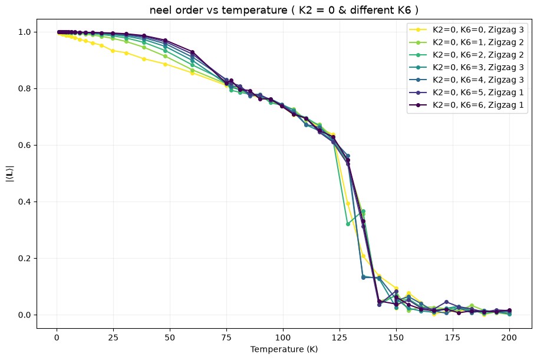
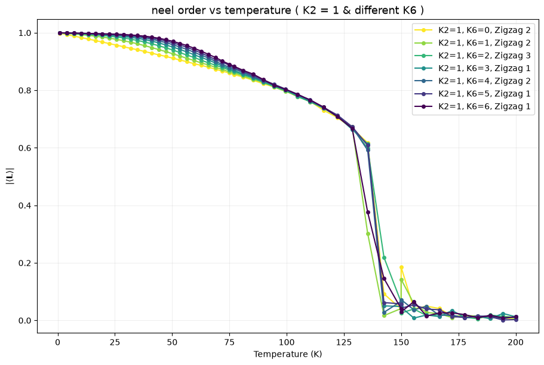
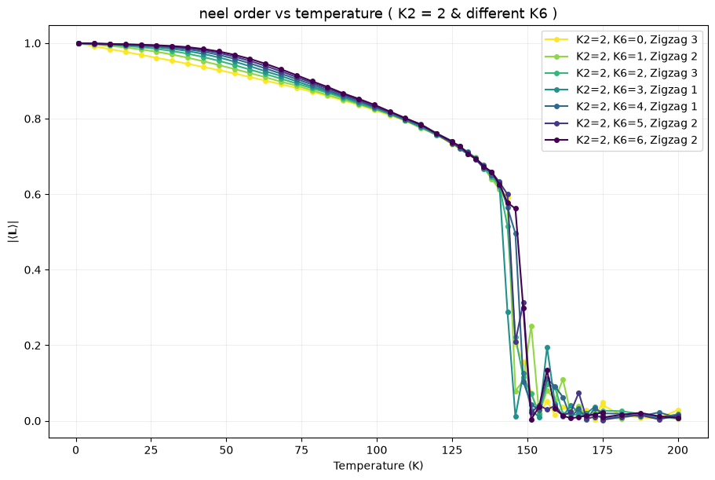

# Six-clock physics in NiPS3

Monte Carlo simulations of classical unit spins on a two-dimensional honeycomb lattice, studying six-clock physics and the temperature dependence of zigzag N?el order.

## Models

Both models include first-, second-, and third-neighbor exchange. Each bond is counted once; energies are in meV and temperatures in K.

**XY model:** $\mathbf S_i=(\cos\phi_i,\sin\phi_i)$.

$$
\mathcal H_{\mathrm{XY}}=
\sum_{n=1}^{3}J_n\sum_{\langle ij\rangle_n}\mathbf S_i\cdot\mathbf S_j
-K_2\sum_i\cos^2\phi_i
-K_6\sum_i\cos(6\phi_i).
$$

**XYZ model:** $\mathbf S_i=(\sin\theta_i\cos\phi_i,\sin\theta_i\sin\phi_i,\cos\theta_i)$, with three spin components on the same two-dimensional lattice.

$$
\mathcal H_{\mathrm{XYZ}}=
\sum_{n=1}^{3}J_n\sum_{\langle ij\rangle_n}\mathbf S_i\cdot\mathbf S_j
-D_{\mathrm{ani}}\sum_i(S_i^z)^2
-K_2\sum_i(S_i^x)^2
-K_6\sum_i\sin^6\theta_i\cos(6\phi_i).
$$

$K_6>0$ favors six in-plane directions, while $K_2>0$ favors the x axis. With the sign convention above, $D_{\mathrm{ani}}<0$ favors the xy plane and $D_{\mathrm{ani}}>0$ favors the z axis. The builders use isotropic exchange: $J_1=-3.8$, $J_2=0.2$, and $J_3=13.8$ meV by default.

## N?el order versus temperature

For each of the three zigzag patterns,

$$
\mathbf L_a=\frac{1}{N}\sum_i\eta_{a,i}\mathbf S_i,
\qquad m_a(T)=\left|\left\langle\mathbf L_a\right\rangle_T\right|,
\qquad a=1,2,3,
$$

where $\eta_{a,i}=\pm1$ specifies the zigzag pattern. We average the vector over measurements before taking its norm. For each run, the channel with the largest value at the lowest temperature is selected and used for the entire curve.

**K2 = 0 meV; varying K6.**

**K2 = 1 meV; varying K6.**

**K2 = 2 meV; varying K6.**

## Notebooks

- [XY model](nisp3_mini_model.ipynb)
- [Parallel scans over K2 and K6](nisp3_mini_model_parallel.ipynb)
- [XYZ model](nisp3_3dxyz_model.ipynb)
