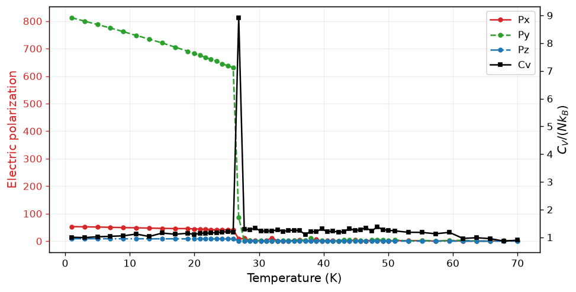
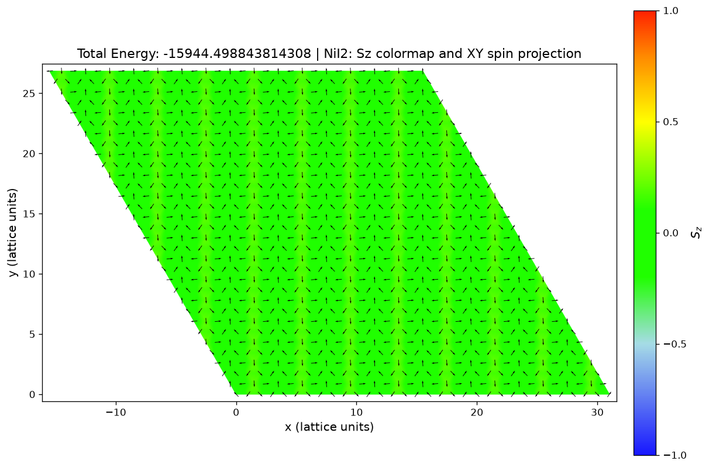
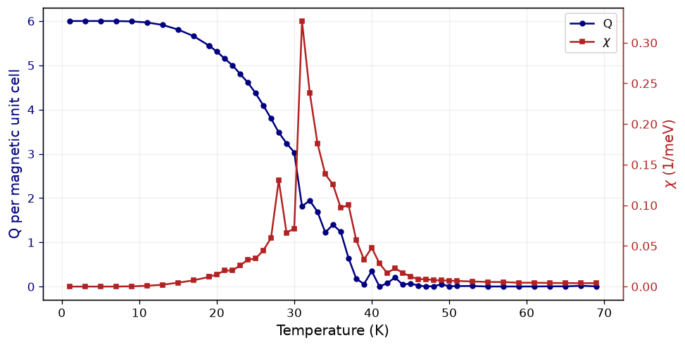
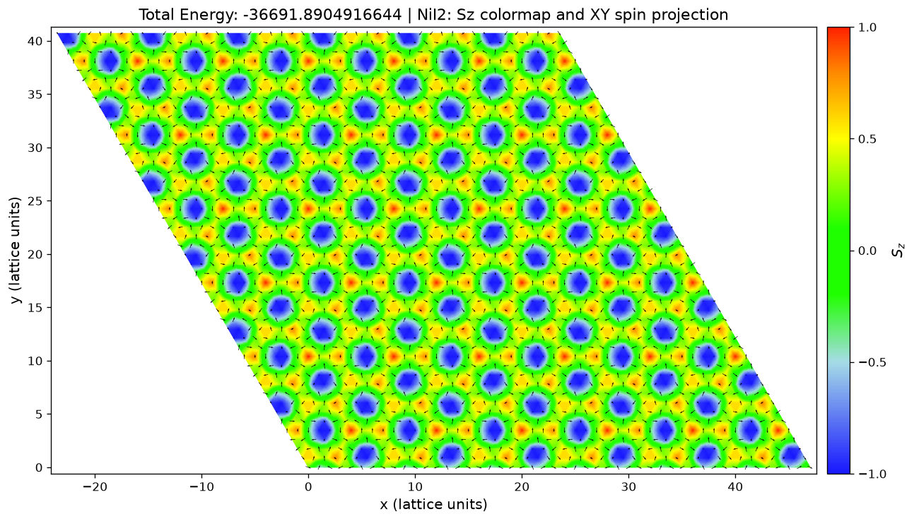
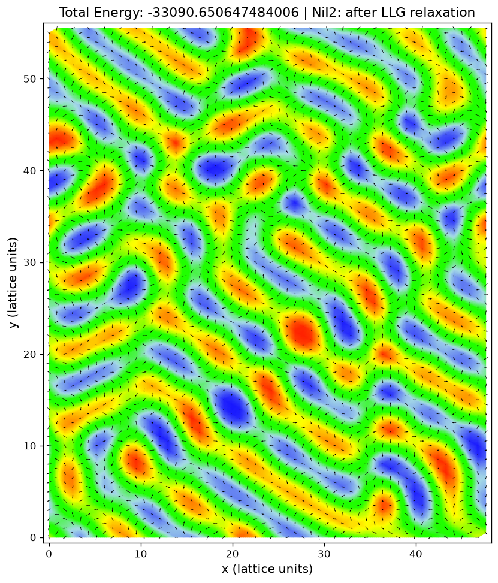
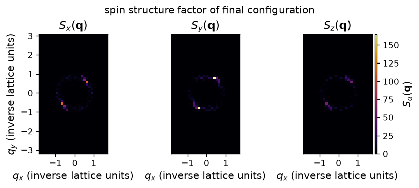
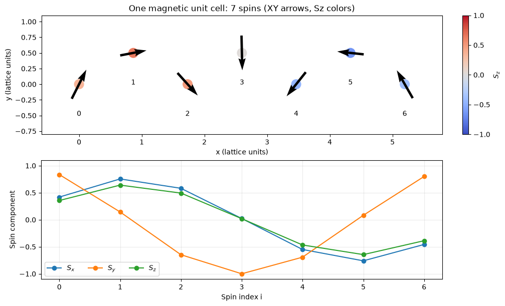
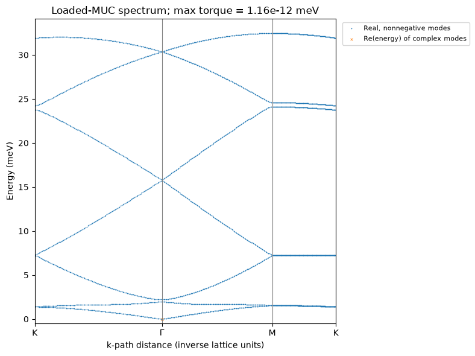

# NiX2 Spin Models: Monte Carlo Simulations and Magnetic Order

This repository studies classical spin models of NiX2, with a focus on NiI2. Monte Carlo temperature annealing is used to search for magnetic ground states across different interaction parameters and to examine their thermal behavior. The calculations connect magnetic textures with electric polarization, topology, and spin excitations.

Two model families are explored: the **mini model** based on the 2020 *Nature Communications* study and the **JKJ3B model** based on the 2023 *Physical Review Letters* study. Simulations support both triangular and rectangular representations of the triangular Ni lattice, with periodic boundary conditions.

## Spin models

### Mini model

The mini model follows the exchange-tensor description used in [*Spontaneous skyrmionic lattice from anisotropic symmetric exchange in a Ni-halide monolayer*, Nature Communications (2020)](https://www.nature.com/articles/s41467-020-19535-w). It includes competing exchange interactions and symmetric exchange anisotropy, allowing us to explore noncollinear magnetic textures and their topological charge.

In this repository, exchange tensors, further-neighbor couplings, single-ion anisotropy, and an external magnetic field can be adjusted to investigate different parameter regimes.

### JKJ3B model

The JKJ3B model is based on [*Realistic Spin Model for Multiferroic NiI2*, Physical Review Letters **131**, 036701 (2023)](https://journals.aps.org/prl/abstract/10.1103/PhysRevLett.131.036701). Its central interactions are nearest-neighbor Heisenberg exchange, Kitaev coupling, third-neighbor exchange, and nearest-neighbor biquadratic exchange.

The competition between these interactions can stabilize helical magnetic order. Parameter scans, including changes in the ratio of third-neighbor to nearest-neighbor exchange, are used to identify the resulting low-energy configurations.

## Monte Carlo simulations and observables

Each temperature point consists of equilibration sweeps followed by measurement sweeps. The final spin configuration is carried into the next temperature point during annealing. Independent runs can be executed in parallel to explore different parameters or random seeds, and LLG relaxation can further minimize the energy of selected configurations.

The two lattice representations are:

- **Triangular:** one spin per crystallographic unit cell.
- **Rectangular:** two spins per crystallographic unit cell, representing the same triangular lattice connectivity.

Available observables include:

| Observable | Description |
| --- | --- |
| Energy, E | Total magnetic energy and its thermal average |
| Magnetization, M | Magnetization vector and magnitude |
| Electric polarization, P | Polarization obtained from bond M tensors acting on spin cross products |
| Heat capacity, Cv | Energy fluctuations, reported per spin in units of kB |
| Topological charge, Q | Sum of oriented solid angles over triangular plaquettes |
| Topological susceptibility, chi | Fluctuations of the magnitude of Q, using the notebook's magnetic-cell normalization |
| Spin structure factor, S(q) | Reciprocal-space map of the final spin configuration |

### Electric polarization and heat capacity

The following simulation illustrates the temperature dependence of the polarization components alongside the heat capacity. The loss of polarization occurs near a pronounced heat-capacity peak in this parameter set.

| Electric polarization and heat capacity | Final MC spin configuration at 1 K |
| :---: | :---: |
|  |  |

Model and geometry parameters from the [saved metadata](nix2_simulation_results/NiX2_polarization__20261102_112650_949591/parameters.json):

| Parameter | Value |
| --- | --- |
| Model | Mini model |
| Lattice geometry | Triangular |
| Size, Nx x Ny x Ns | 32 x 32 x 1 (1,024 spins) |
| J1 tensor, rows in XYZ order (meV) | `[[-8.0, 0, 0], [0, -5.6, -1.4], [0, -1.4, -7.3]]` |
| J2iso (meV) | 0 |
| J3 (meV) | 5.8 |
| Azz (meV) | 4.2 |
| Biquadratic coupling (meV) | 0 |
| External field, (Bx, By, Bz) (T) | (0, 0, 0) |

### Topological charge

A separate parameter set produces a finite low-temperature topological charge that decreases as temperature rises. The figure uses the magnetic-unit-cell normalization defined in the corresponding notebook.

| Topological charge and susceptibility | Final MC spin configuration at 1 K |
| :---: | :---: |
|  |  |

Model and geometry parameters from the [saved metadata](nix2_simulation_results/NiX2_topological_charge__20261103_113734_413179/parameters.json):

| Parameter | Value |
| --- | --- |
| Model | Mini model |
| Lattice geometry | Triangular |
| Size, Nx x Ny x Ns | 48 x 48 x 1 (2,304 spins) |
| J1 tensor, rows in XYZ order (meV) | `[[-8.0, 0, 0], [0, -5.6, -1.4], [0, -1.4, -7.3]]` |
| J2iso (meV) | 0 |
| J3 (meV) | 5.8 |
| Azz (meV) | 0.6 |
| Biquadratic coupling (meV) | 0 |
| External field, (Bx, By, Bz) (T) | (0, 0, 0) |

## Proper-screw magnetic order

Within suitable parameter regions, the simulations can produce **proper-screw order**. This magnetic state is closely related to the NiI2 physics investigated in [*Giant chiral magnetoelectric oscillations in a van der Waals multiferroic*, Nature (2024)](https://www.nature.com/articles/s41586-024-07678-5), which also considers excitations in a 7 x 1 magnetic supercell.

### Simulated domains and spin structure factor

The following JKJ3B result shows the final spin configuration after LLG relaxation and its component-resolved structure factor (see [model parameters](nix2_simulation_results/NiX2_JKJ3B_proper_screw_order__20261103_134444_352647/parameters.json)).

  

  

For Cartesian peak coordinates in units of $a^{-1}$, the spiral period along the propagation direction is

$$
\frac{\lambda}{a}=\frac{2\pi}{\sqrt{(a q_x)^2+(a q_y)^2}}.
$$

Here, $a$ is the nearest-neighbor distance; the lattice-vector lengths and angles are already included in the conversion to Cartesian wave vectors. Selected peak positions from the notebook are listed below; the corresponding negative wave vectors give the same periods.

| $a q_x$ | $a q_y$ | $\lambda/a$ |
| ---: | ---: | ---: |
| 0.647785 | 0.560999 | 7.33 |
| 0.518228 | 0.673198 | 7.40 |
| 0.388671 | 0.785398 | 7.17 |
| 0.388671 | 0.897598 | 6.42 |

The first three peaks indicate periods close to seven nearest-neighbor spacings. The texture contains several domains and curved stripes rather than a uniform seven-site spiral. These periods support a near-seven-site spiral length scale, but identifying proper-screw order also requires checking the local spin-rotation plane relative to the propagation direction.

## 7 x 1 magnetic unit cell relaxation
For the commensurate configuration studied here, the order is described using a **7 x 1 magnetic unit cell containing seven spins**. The figure below shows the spin orientations from our best simulation result to date. Black arrows represent the XY projections, site colors indicate Sz, and the lower panel shows all three spin components across the magnetic unit cell.

  

## Magnon spectra above the proper-screw state

Using the relaxed proper-screw configuration as the reference state, we can calculate the magnon spectrum of the JKJ3B model. The example below shows the excitation energies along the K-Gamma-M-K path in reciprocal space.

  

These figures are simulation results from this repository, rather than reproductions of the figures in the cited papers.

## Notebooks

| Notebook | Focus |
| --- | --- |
| [nix2_mini_model_polarization.ipynb](nix2_mini_model_polarization.ipynb) | Mini-model polarization and thermal observables |
| [nix2_mini_model_topological_charge.ipynb](nix2_mini_model_topological_charge.ipynb) | Mini-model topological charge and susceptibility |
| [nix2_JKJ3B_model_mc.ipynb](nix2_JKJ3B_model_mc.ipynb) | Monte Carlo simulations of the JKJ3B model |
| [nix2_mc_parallel.ipynb](nix2_mc_parallel.ipynb) | Parallel parameter scans and comparisons of final configurations |
| [nix2_JKJ3B_LLG_Magnon.ipynb](nix2_JKJ3B_LLG_Magnon.ipynb) | LLG relaxation and magnon calculations |

The Python modules provide model builders, Numba-accelerated Monte Carlo kernels, sampling protocols, LLG dynamics, plotting, and result storage. The main dependencies are NumPy, SciPy, Numba, and Matplotlib; the notebooks run in Jupyter.
